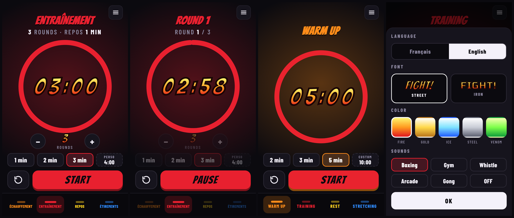

# 🥊 Ring Timer

**A free, dead-simple boxing & workout interval timer. Not for sale.**



**Try it:** https://jpx2882.github.io/ring-timer

## Features

- **4 modes** at the bottom of the screen: Warm up (orange), Training (red), Rest (yellow), Stretching (blue)
- Adjustable **rounds** with − / +, with automatic rest between rounds
- One-tap time **presets**, plus a **Custom** button for any time
- **Fighting-game style**: 2 fonts (Street, Iron) and 5 text colors (Fire, Gold, Ice, Steel, Venom)
- **5 sound themes**: Boxing bell, Gym buzzer, Whistle, Arcade, Gong
- 3-2-1 countdown, 10-second warning, screen stays on while the timer runs
- **English / French**
- Everything is **saved** on your device. No ads, no account, no data collected.

## Install on your phone (web app)

1. Open https://jpx2882.github.io/ring-timer in Safari (iPhone) or Chrome (Android).
2. Tap **Share → Add to Home Screen**.
3. Launch it from the icon: it runs full screen and works offline.

## Install on Android (APK)

1. On your Android phone, download **RingTimer.apk** from the
   [latest release](https://github.com/jpx2882/ring-timer/releases/latest/download/RingTimer.apk).
2. Open the file. If Android asks, allow installing apps from your browser or file manager.
3. Tap **Install**.

The APK is built automatically by GitHub Actions from the `android/` folder.

## Build the Android app yourself

Open the `android/` folder in Android Studio and press ▶︎, or run `./gradlew assembleRelease` in `android/`.

## Build the iPhone app (Xcode)

Requires a Mac with Xcode 16 or newer.

1. Open `ios/RingTimer.xcodeproj`.
2. In **Signing & Capabilities → Team**, pick your Apple ID. Change the *Bundle Identifier* if Xcode says it is taken.
3. Plug in your iPhone and turn on **Developer Mode** (Settings → Privacy & Security → Developer Mode).
4. Select your iPhone at the top of Xcode and press ▶︎.
5. If iOS blocks the app, go to Settings → General → VPN & Device Management and trust your developer profile.

With a free Apple account, the app must be reinstalled from Xcode every 7 days.

## Project structure

```
docs/          Web app (installable PWA, works offline), served by GitHub Pages
ios/           Native SwiftUI app (Xcode project, iOS 17+)
android/       Native Kotlin + Jetpack Compose app (Android 8+)
screenshots/   Images used in this README
```

## Contributing

Ideas, bug reports and improvements are welcome: open an issue or a pull request.

## License

The code is licensed under [PolyForm Noncommercial 1.0.0](LICENSE.md).

- ✅ You may use it, install it on your own devices, modify it and share it **for free**.
- ❌ **Selling it, or any other commercial use, is not allowed.**
- If you share a modified version, please use a different name and icon.

Copyright (c) 2026 jpx2882. Fonts (Bangers, Russo One, Barlow Condensed) are under the SIL Open Font License 1.1.
